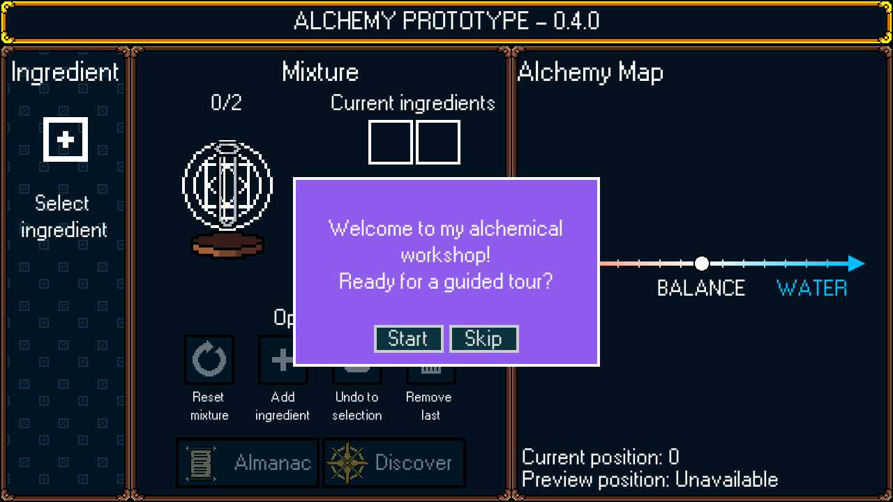
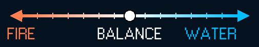
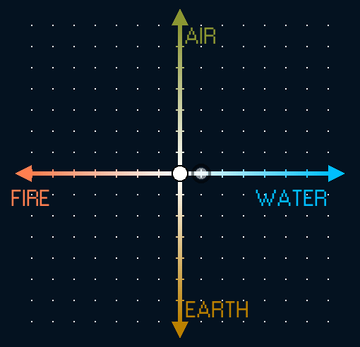
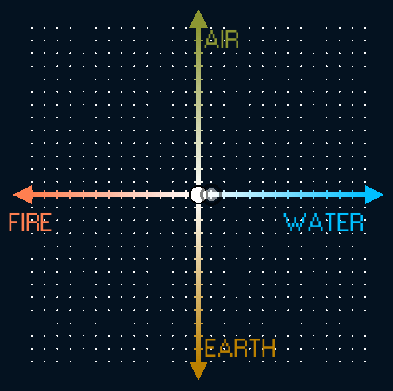
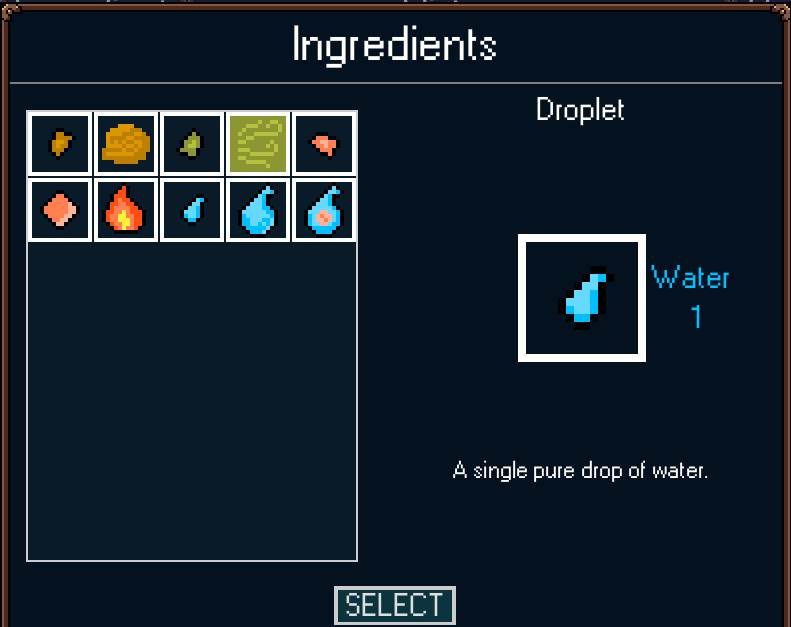
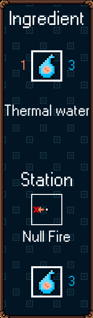
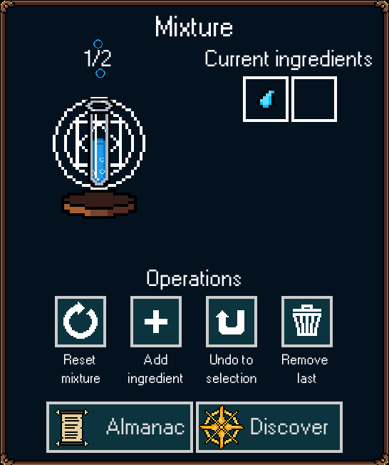
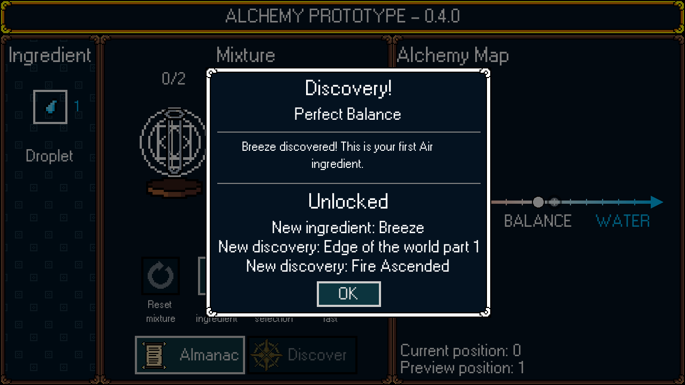
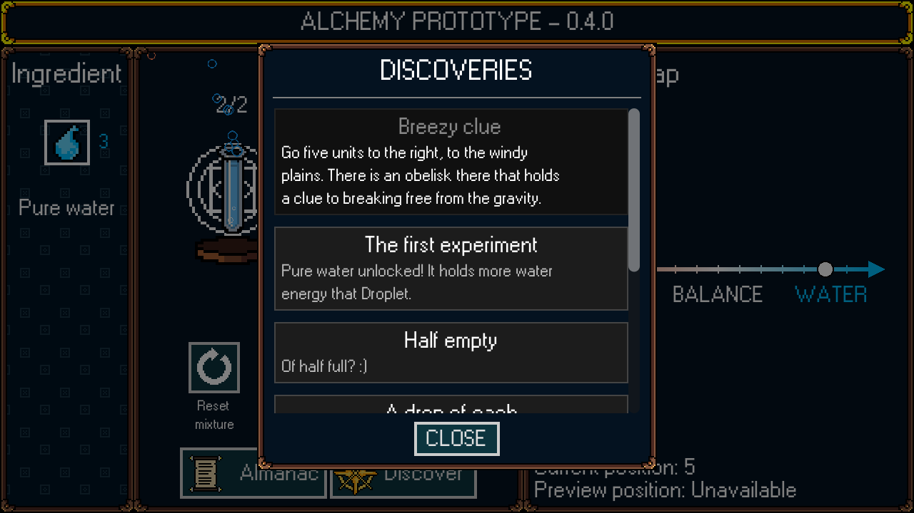

# Alchemy — Game Prototype

A 2D alchemy experimentation game built with **Godot 4**. Explore the relationships between
 elemental energies, create mixtures, and discover new alchemical wonders.

> **Project status:** Prototype  
> This repository contains an early gameplay implementation focused on experimentation, discovery, and core systems.

## Overview

The player explores the Map of Alchemy by crafting mixtures. Player's position on the alchemy map
 is determined by mixture's elemental energy.

By combining ingredients and applying ingredient processing, the player attempts to reach
 discoveries and unlock new discoveries, ingredients, processing stations, and raise the mixture capacity.

The central gameplay loop is:

**Check Almanac for Discoveries → Create Mixture → Discover → Experiment again**

## Core Mechanics

### 1. The Map of Alchemy

The Map of Alchemy is first presented to the player as a number line with Fire to the left and Water
 to the right. The maximum shown value is 6 on each side.

As the game progresses, another axis is revealed - Air/Earth.

When the player unlocks stronger ingredients and bigger flasks, the map expands in four directions.

### 1. Ingredients

Each ingredient has four energy values:

- `fire`
- `water`
- `air`
- `earth`

The ingredient's movement is calculated as 2D vector (positive values up and right):

`(water - fire, air - earth)`

The player can inspect an ingredient's composition and see the preview marker to understand how
 adding an ingredient will affect the mixture.

### 2. Processing stations

Processing stations provide a way to manipulate ingredient's elemental energy. An ingredient can be
 processed by at most one station.

Currently implemented stations:
- No processing - retains the original energies of the ingredient
- Null Fire - removes fire energy from ingredient
- Null Water - removes water energy from ingredient 

Null Fire removes fire energy from Thermal Water.

### 3. Mixtures

Ingredients can be combined into a mixture.

The prototype starts with a mixture capacity of **two ingredients**. Discoveries can raise mixture capacity.

The mixture's total energies are the sums of the energies contributed by its entries.

### 4. Discoveries

Discoveries are the primary progression system. They can thought of as quests.

Each discovery is associated with a rectangular area on the alchemy map and an energy requirement.
When the mixture contains at least one ingredient, the player can attempt to discover something.
If the mixure's position is contained by the rectangular area and the energy requirement is 
satisfied, the Discovery is unlocked.

Discoveries can reward the player with:
- New ingredients
- New processing stations
- Higher mixture capacity
- Further discoveries

The player can see both discovered and undiscovered entries in Discovery Journal.

 

## Resource Model

The prototype uses custom Godot Resources to define game content:
- Ingredients
- Discoveries
- Processing Stations

## Tutorial

The tutorial is implemented as a sequence of interactions, teaching the player basics of mixture crafting.

It uses signals and `await` to pause until the player performs an action, such as selecting an ingredient, adding it to the mixture, or attempting a discovery.

This keeps the tutorial aligned with actual gameplay and allows UI components to retain ownership of their own controls.

## Running the game

The executable for 0.4.0 is available on my [Google Drive](https://drive.google.com/file/d/12rZnfpSfA-6b8YVssQACLsm9uhMzIRxl/view?usp=drive_link).

## Building the Project

1. Install a compatible version of **Godot 4**.
2. Clone or download this repository.
3. Open the project using Godot's Project Manager.
4. Run the configured main scene.

The project is a prototype, so scene setup, resource definitions, and input behavior may change as the mechanics evolve.

## Current Scope

The prototype focuses on validating the central experimentation loop:

- [x] 4-Elemental energy model
- [x] Ingredient composition and mixture calculations
- [x] Two-dimensional elemental space 
- [x] Current and preview mixture positions
- [x] Discovery rewards and progression
- [x] Mixture capacity progression
- [x] Guided first-experiment tutorial
- [x] Discovery result and journal UI

## Future Development

Potential areas for further development include:

UX:
- Instead of selecting an ingredient and adding it with a separate button, individual mixture slots should be clickable
- Better UI for Discovery Journal - ideally graph with Discoveries as nodes and edges representing the hierarchy 
- Pinning Discoveries to main screen 
- Better feedback for failed experiments

Architecture:
- Alchemy Map implementation with nodes - currently it is drawn directly on canvas, which limits customization options

Content:
- More discoveries
- Further balancing and playtesting

These are possible directions rather than commitments for the current prototype.
